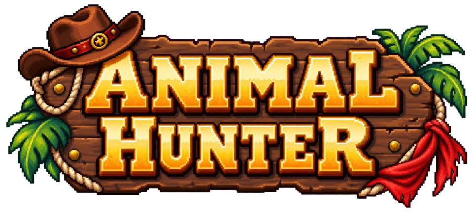

# Animal Hunter



A pixel-art platformer built in **GDevelop 5**. Explore a tropical island, fight patrol crabs, collect supplies, find the brass key, and reach the exit. Opening the treasure chest reveals a developer-credits easter egg.

## Open and play

1. Clone or download this repository, including its `assets/` directory.
2. In GDevelop, choose **Open a project** and open **[Animal Hunter.json](Animal%20Hunter.json)** at the repository root.
3. Preview the project to start at the opening menu, or preview `permainan` directly while developing the level.

The project was last saved with GDevelop **5.6.283**. Use GDevelop to run and export the game. Node.js 18+ is only needed for the optional repository tools below; they have no package dependencies.

## Controls

| Action | Keyboard / control |
| --- | --- |
| Move | Arrow keys or A / D |
| Jump | Space or W; briefly hold for a higher jump |
| Shoot | J or X; hold to repeat |
| Pause / continue | P or Escape; pause/play icon |
| Help | H or question-mark icon |
| Replay | R or circular-arrow icon |
| Return to opening | House icon in the pause/result menu |
| Start | Enter or the large play icon |
| View credits | Scroll/quill icon, or open the keyed treasure chest |

Escape closes help/credits. Credits opened from the pause panel return to that paused panel. The play icon closes the chest credits and resumes the adventure.

## Gameplay

- **Four island sections:** gaps, raised platforms, scenery, patrol enemies, supplies, and 16 coins.
- **Native platformer physics:** gravity, acceleration, jumping, and terrain collision use GDevelop's Platformer / Platform behaviors.
- **Combat:** crabs take two shots and damage the player on contact. They can also be stomped from above.
- **Inventory:** start with 3 health, 3 lives, and 20 rounds. Ammo pickups give 8 rounds, up to 40; hearts restore one health.
- **Checkpoints:** the flag restores health and saves a respawn position. Falling or losing all health costs one life.
- **Progression:** collect the brass key to unlock the chest and the exit. Coins are optional score bonuses.
- **Results:** dedicated winner and game-over scenes show the run's score and coin total, with replay/home controls.
- **Chest easter egg:** the game pauses, the treasure chest opens in a popup, and the developer portraits and credits appear. The reward is granted once per run.
- **Icon HUD:** pause, continue, replay, home, help, and credits use the game's artwork instead of text labels on buttons.

The source art includes 8 player states: Idle, Run, Jump, Fall, Land, Hurt, Shoot, and Death. The current level is 4096 x 720 world units; the base camera follows the player while the background and HUD remain fixed.

## Repository layout

```text
Animal Hunter.json                 Main GDevelop project
assets/
  cowboy-island-pack-v1/            Player frames, terrain, props, enemies, effects and UI
  animal-hunter-ui-v1/              Title logo and menu/result icons
  developer-portraits-v1/           Supplied developer portraits
  legacy/
    root/                          Earlier loose artwork, preserved for reference
    imports/                       Earlier editor-imported frames and textures
docs/
  game-guide.md                    Scenes, game rules, events and tuning
  chest-credits.md                 Chest reveal and credit details
  asset-audit.json                 Resource-catalog cleanup record
src/events/
  gameplay.js                      Editable game-rule event source
  ui.js                            Shared menu, HUD, pause and credits source
scripts/
  check-project.mjs                Project/resource/JavaScript checks
  sync-events.mjs                  Pull or push event source
package.json                       Optional maintenance commands
.gitignore                         Local recovery/editor/output exclusions
.gitattributes                     Consistent text line endings and binary asset handling
```

`assets/legacy/` preserves older artwork; it does not contain the main player or menu assets used by the current game. Existing generated asset folders keep their names so their manifests and references stay understandable. The active project's resource catalog contains only retained references; obsolete unused registrations were removed without deleting the artwork.

Local backups, autosaves, prepared-project copies, old runtime reports, contact-sheet previews, and one-off import helpers are preserved under **`.local/`** and excluded from Git. Use Git history for shared historical versions. `.git/` and the current branch are unchanged.

## Development workflows

### Editing in GDevelop

1. Open `Animal Hunter.json` and edit scenes, object properties, behaviors, or events.
2. Save the project.
3. If you changed JavaScript events, update the readable source files:

   ```sh
   npm run events:pull
   ```

4. Run the repository checks, then preview the affected scenes in GDevelop:

   ```sh
   npm run check
   ```

### Editing the JavaScript source

1. Close the project in GDevelop to prevent an older open editor state from overwriting the update.
2. Edit `src/events/gameplay.js` or `src/events/ui.js`.
3. Review the planned synchronization and apply it:

   ```sh
   npm run events:push -- --dry-run
   npm run events:push
   npm run check
   ```

4. Reopen `Animal Hunter.json` and preview the game.

The push command updates the matching embedded events and creates an ignored recovery copy in `.local/backups/event-sync/`. The UI source is shared by all four scenes. Pulling stops if those scene copies differ, so it cannot silently choose one version over another. These commands also work as `node scripts/sync-events.mjs pull` / `push` and `node scripts/check-project.mjs`.

The main project remains the source of truth for scene layouts, object definitions, behaviors, and event structure. Source files and embedded JavaScript are synchronized explicitly; there is no background auto-sync.

## Scenes and event groups

| Scene | Purpose |
| --- | --- |
| `opening` | Title, play, help, credits and exit |
| `permainan` | Playable island level and icon HUD |
| `winner` | Ending, final run data, replay/home/credits |
| `game over` | Loss result, final run data, replay/home/credits |

Gameplay events are grouped into icon UI, native Platformer controls, native Platformer animation conditions, and game rules. Keep the player frames at **128 x 128** with their shared origin and body collision mask **(45,32)–(83,112)** when replacing animation art.

More detail: [game development guide](docs/game-guide.md), [chest and credits guide](docs/chest-credits.md), [asset pack guide](assets/cowboy-island-pack-v1/README.md), and [asset manifest](assets/cowboy-island-pack-v1/manifest.json).

## Developers

| Developer | Role | NIM |
| --- | --- | --- |
| Syahruzzahid | Programmer | 2405336104 |
| Nazwa Hilmia Zida | Artist | 24053360454 |
| Syarifatus Sholihah | Level Design | 240533602750 |

The in-game credits use the supplied portraits and the names/NIMs above. Generation prompts for the game artwork remain in the corresponding asset folders.

## Checks before a pull request

- Run `npm run check`: it checks scene/object references, local resource paths, PNG signatures, registered image references, and embedded JavaScript syntax.
- If you changed event code, confirm source synchronization with `npm run events:push -- --dry-run`.
- Preview the affected scenes in GDevelop. For gameplay/UI changes, check movement/jumping, pause/continue, replay/home, and the chest-to-credits sequence.
- Commit the project, assets, source, scripts and relevant documentation together. Local backups, autosaves, exported builds and Codex state should stay ignored.

No dependency installation or generated export is required to open the repository in GDevelop.
